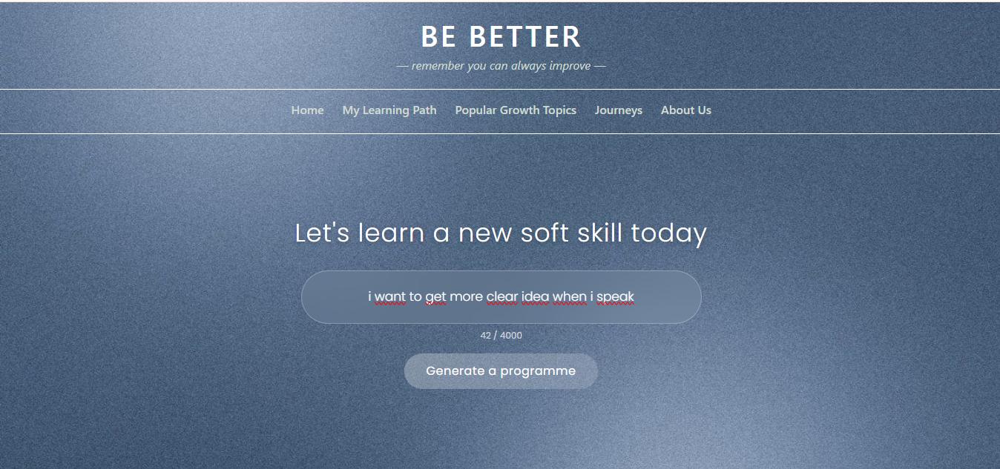
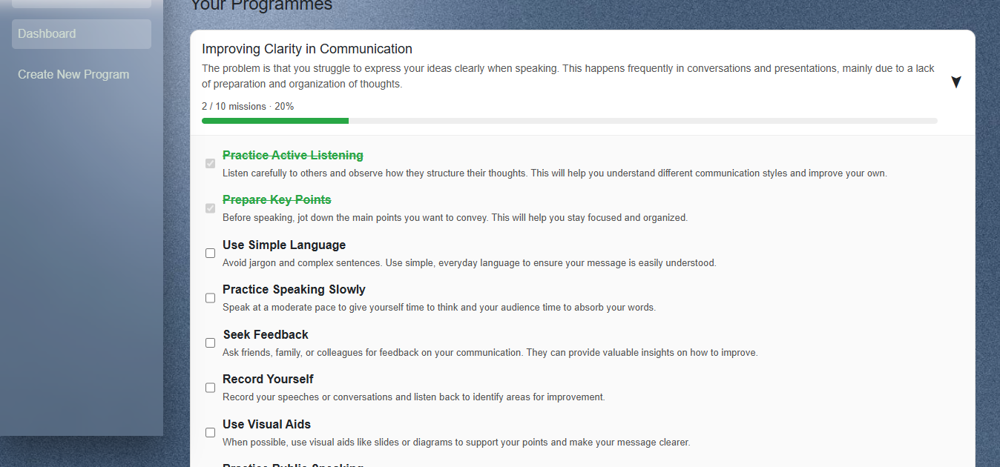
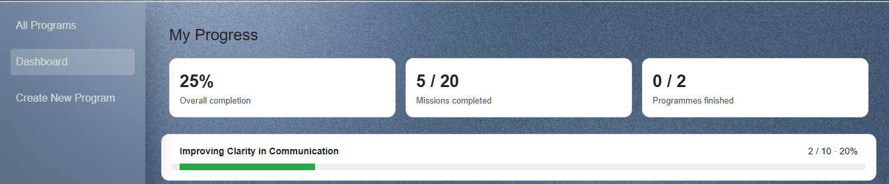
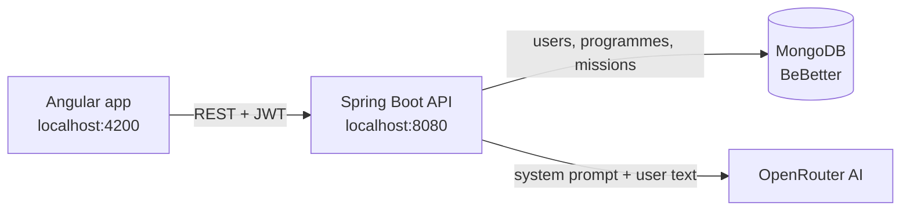

# BE BETTER

*Remember you can always improve.*

BE BETTER turns a soft-skills problem, described in a few sentences, into a personal programme of 5 to 10 practical missions generated by AI. You confirm each mission as you complete it and follow your progress per programme and overall.



## Features

- **AI-generated programmes:** describe a problem (max 4000 characters) or pick a suggested topic, and get a programme with a diagnosis and 5 to 10 missions, in the language you wrote in.
- **Off-topic filter:** requests that are not about soft skills or personal development (homework, code, recipes, random text) are refused with a short explanation.
- **Mission tracking:** confirm missions as done; each programme shows a progress bar.
- **Progress dashboard:** overall completion, missions completed, and programmes finished.
- **Accounts:** sign up and sign in with JWT authentication; user and admin roles.

| Programmes and missions | Dashboard |
| --- | --- |
|  |  |

## Tech stack

| Layer | Technology |
| --- | --- |
| Frontend | Angular 19 (standalone components), Bootstrap 5 |
| Backend | Spring Boot 3.5, Java 17, Spring Security, JWT (jjwt), Swagger (springdoc) |
| Database | MongoDB |
| AI | [OpenRouter](https://openrouter.ai) chat API, default model `mistralai/mistral-small-3.2-24b-instruct` |

## Architecture



Each user is stored as one MongoDB document that holds their programmes (`Subject`) and each programme's missions (`Mission`).

## Getting started

### Prerequisites

- Java 17
- Node.js and npm
- MongoDB running on `localhost:27017`
- An [OpenRouter](https://openrouter.ai) account with a little credit (one programme costs about $0.0003 with the default model)

### 1. Configure the backend

The real configuration file is git-ignored because it holds secrets. Create it from the template:

```bash
cd bebetter-backend/src/main/resources
cp application.properties.example application.properties
```

Then edit `application.properties`:

- `openrouter.api.key`: your key from [openrouter.ai/keys](https://openrouter.ai/keys).
- `app.jwt.secret`: a random string of at least 64 characters. You can generate one with:

```bash
python -c "import secrets; print(secrets.token_urlsafe(64))"
```

### 2. Run the backend

```bash
cd bebetter-backend
./mvnw spring-boot:run        # Windows: mvnw.cmd spring-boot:run
```

The API starts on `http://localhost:8080`. Swagger UI: `http://localhost:8080/swagger-ui.html`.

### 3. Run the frontend

```bash
cd BEBETTER_FRONT
npm install
npm start
```

Open `http://localhost:4200`, create an account, and generate your first programme.

## Configuration

| Property | Purpose |
| --- | --- |
| `spring.data.mongodb.uri` | MongoDB connection string |
| `openrouter.api.url` | OpenRouter chat endpoint |
| `openrouter.api.key` | OpenRouter API key (secret) |
| `openrouter.model` | AI model used to generate programmes |
| `app.prompt.subject-coach` | File holding the coach's system prompt |
| `app.cors.allowed-origins` | Allowed front-end origins, comma-separated |
| `app.jwt.secret` | JWT signing secret, at least 64 characters (secret) |
| `app.jwt.expiration-ms` | Token lifetime in milliseconds (default 10 hours) |

The AI coach's instructions live in [`subject-coach-prompt.txt`](bebetter-backend/src/main/resources/prompts/subject-coach-prompt.txt). Edit that file and restart the backend to change how programmes are written.

## API overview

| Method | Path | Description |
| --- | --- | --- |
| POST | `/auth/register` | Create an account, returns a JWT |
| POST | `/auth/login` | Sign in, returns a JWT |
| POST | `/subject/newSubjects/{username}` | Generate a programme from a prompt |
| GET | `/subject/getAllSubjects/{username}` | List a user's programmes |
| GET | `/subject/getSubject/{username}/{subjectId}` | One programme with its missions |
| PUT | `/subject/done/{username}/{subjectId}/{missionId}` | Mark a mission as done |
| DELETE | `/subject/deleteSubject/{username}/{subjectId}` | Delete a programme |
| GET | `/user/{username}` | User profile |

All endpoints except `/auth/*` and Swagger need an `Authorization: Bearer <token>` header. The full reference, including user/admin endpoints and error codes, is in the [project documentation](docs/BeBetter-Documentation.pdf).

## Project structure

```
BE BETTER PROJECT/
├── BEBETTER_FRONT/                 Angular frontend
│   └── src/app/
│       ├── auth/                   login and sign-up pages
│       ├── core/auth/              AuthService, guard, JWT interceptor
│       ├── features/programme/     programmes list, detail, dashboard
│       └── pages/                  home, about us
├── bebetter-backend/               Spring Boot backend
│   └── src/main/
│       ├── java/.../bebetter_backend/
│       │   ├── controller/         REST endpoints
│       │   ├── entity/             Utilisateur, Subject, Mission
│       │   ├── security/           JWT, CORS, Spring Security config
│       │   └── service/            business logic and AI call
│       └── resources/
│           ├── application.properties.example
│           └── prompts/subject-coach-prompt.txt
└── docs/                           documentation PDF and screenshots
```

## Security notes

- Secrets (`openrouter.api.key`, `app.jwt.secret`) live only in `application.properties`, which is git-ignored. Never commit it.
- Passwords are hashed with BCrypt. New accounts always get `ROLE_USER`; admins are promoted directly in the database (`role: "ROLE_ADMIN"`).
- Changing `app.jwt.secret` signs everyone out.

## Documentation

- [Project documentation (PDF)](docs/BeBetter-Documentation.pdf): architecture, configuration, full API reference, AI generation, troubleshooting.

## Author

[Mohamed Ghzaiel](https://github.com/ghzaiell)
